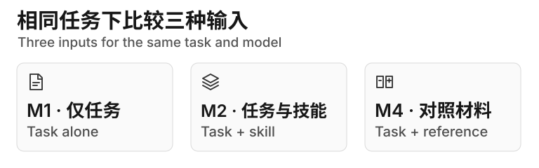

# SkillFit

English · [简体中文](README.md)

Compare how a model performs on the same task with a skill, without it and with reference material. The static matrix lets you browse historical scores and see which pairings have enough controls for a comparison.



## Open the matrix

From the repository root, use Python 3.10+ to serve the bundled snapshot. Open <http://127.0.0.1:8000> in a browser.

```sh
python3 -m http.server 8000 --bind 127.0.0.1 --directory site
```

Inspect coverage for one skill without making a model request:

```sh
python3 tools/value_audit.py --site-data site/data.json --skills humanizer --format markdown
```

Most public entries have only a score with the skill loaded. Estimating its contribution requires matched tasks, controls and common judges. The offline audit reports missing evidence. Model runs use a separately configured CLI or API and may incur charges.

[Measurement method](docs/measurement-audit.md) · [Reproducibility guide](docs/reproducibility-review.md) · [Example task](example-tasks/format-check/) · [MIT license](LICENSE)
