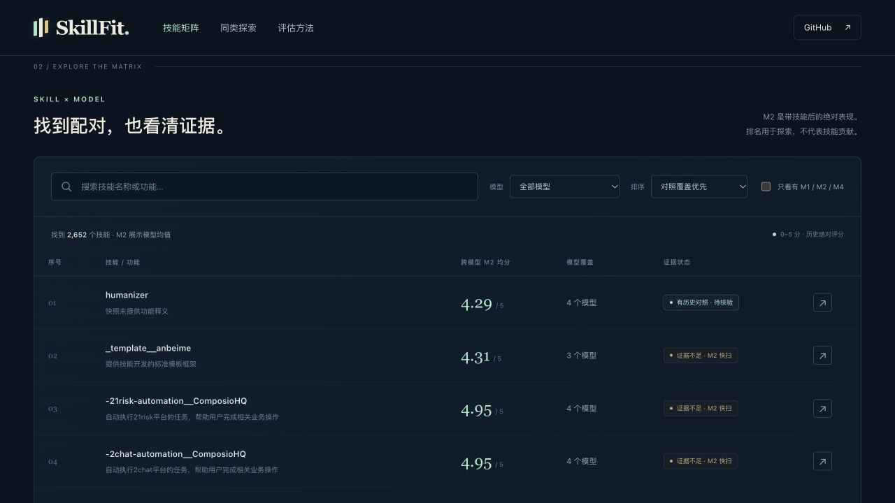
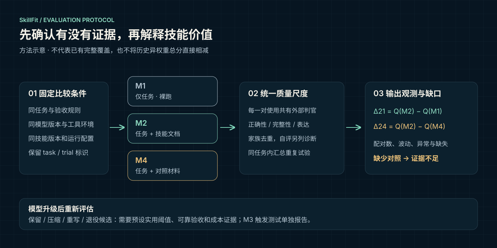

<div align="center">

# SkillFit

**模型变强之后，哪些 Skill 还值得加载？**

技能 × 模型的配对探索、增益审计与升级回归。

[](LICENSE)
[](site/)
[](docs/measurement-audit.md)


[可行性评估](docs/feasibility-review.md) · [评分审计](docs/measurement-audit.md) · [复现说明](docs/reproducibility-review.md) · [技能目录](SKILLS.md)

</div>

## 为什么继续做

通用写作套路、公开知识和简单规划可能被更强的模型覆盖。一个技能在旧模型上有效，不代表它值得长期加载；带技能后的高分，也可能主要来自模型本身。

SkillFit 的机会是帮助技能作者和团队维护自己的配置：**固定任务与验收，在每个模型版本上重新检查技能的贡献，找出应保留、精简、重写或进入退役复核的候选。** 私有规则、可执行资产和验收流程仍可能有价值，但同样需要实测。

| 技能内容 | 被模型能力覆盖的风险 | 应该验证什么 |
|---|---|---|
| 通用提示、文风规则、简单规划 | 高 | 裸跑或简短直接指令能否达到相同验收结果 |
| 公开领域知识、工具用法 | 中高 | 与官方文档检索、直接工具调用相比是否有额外收益 |
| 多步流程、脚本、模板 | 依具体实现而定 | 真实执行成功率、恢复能力、耗时和维护成本 |
| 私有规范、近期业务规则、系统上下文 | 知识被训练吸收的风险较低 | 加载后的遵循情况，以及其他上下文机制能否更经济地承载 |

这是**有条件可行的方向**，尚未验证产品需求或建立商业壁垒。模型越强，评测对象越应从“谁得分高”转向“哪些额外配置仍值得存在”。具体试点与停止条件见[可行性报告](docs/feasibility-review.md)。

## 现在能做什么

- **探索历史配对**：按技能、模型和对照覆盖搜索筛选；查看 M2 绝对表现、原始判官方阵和缺失数据。
- **检查证据覆盖**：公开快照可离线审计；缺少原始评分、试验号或对照时，返回 `insufficient_evidence`。
- **重算配对观测**：本地有原始产物与评分时，按相同技能、模型、任务、trial 和共有外部判官重新计算质量差。
- **运行文本实验**：支持 M1/M2/M4 与 CLI 的 M3 触发模拟；附自包含示例和无需请求模型的提示词预览。

网站采用深墨蓝、奶白、薄荷绿和琥珀色，与封面保持一致。前端直接读取 `site/data.json`，无需构建或外部 CDN；包含分页、无结果与加载失败状态，以及可键盘操作的详情窗口。站点生成器使用外置前端资产，刷新数据不会恢复旧 UI。

<details>
<summary>实际网页预览</summary>




</details>

## 先读数据边界

公开基线快照（2026-10-27 导出）含 **2,652** 个技能条目，其中 **2,651** 个有 M2 均分，只有 **1** 个技能有 M1/M4 聚合记录。大多数任务要求概括并演示技能文档，属于文本快扫，不能代表完整工作流效果。网页会根据实际载入的快照重新计数；导出时间不等于重新评测时间。

旧 `SkillScore` 主要衡量带技能后的绝对表现，缺少 M3 时还会填入默认触发分。历史 M1、M2、M4 使用过不同的评分权重，多试验聚合也存在覆盖问题。因此，旧榜单、百分位和 `gains` 字段仅保留为探索资料，**不能直接用来证明技能增益或模型替代关系**。

新审计工具统一使用正确性、完整性、表达清晰三个公共维度，并保留每个配对的试验号与共有判官。它修正可恢复的计算口径，不能补出缺失实验、固定服务端模型版本或追认旧实验的因果有效性。[完整审计与本地重算观察](docs/measurement-audit.md)

## 怎么衡量技能价值



| 模式 | 输入 | 用途与限制 |
|---|---|---|
| M1 | 任务 | 模型裸跑基线 |
| M2 | 任务 + 技能文档 | 当前执行器为纯文本通道，禁用脚本与外部工具 |
| M3 | 任务 + 技能清单，可用 Read | 触发正负例测试；仅 CLI，单独报告 |
| M4 | 任务 + 参考材料 | 字符数匹配的对照，不保证 token 等长或语义完全无关 |

新工具对三模式都按同一个质量函数计算：

```text
Q = 0.55 × 正确性 + 0.30 × 完整性 + 0.15 × 表达清晰   （0–5）
Δ21 = Q(M2) − Q(M1)    加载技能相对裸跑的观测差
Δ24 = Q(M2) − Q(M4)    相对所选对照材料的观测差
```

每一对只使用共有外部判官，默认至少两个家族；家族内均值、家族间中位数，自评另列诊断。先在同任务内汇总重复试验，再对任务等权平均。重复试验不足时不制造置信区间；M4 可能引入干扰，Δ24 不能无条件称为“纯内容因果增益”。

判断退役还需要预先定义实用等效范围、可靠验收、成本和时延约束。“差异不显著”不等于“模型已经替代技能”。当前工具输出配对观测与缺口，自动退役决策尚未实现。

## 快速开始

需要 Python 3.10+。批跑器使用 `fcntl`，Windows 请用 WSL；静态网站和增益审计仅需 Python 标准库。

```bash
git clone https://github.com/8eeth0ven/skillfit.git
cd skillfit

# 1. 看网站：在浏览器打开 http://localhost:8000
python3 -m http.server 8000 --directory site
```

另开终端，在仓库根目录执行离线检查，无需 CodeBuddy 或 API key：

```bash
# 2. 审计公开快照。聚合数据只检查覆盖，不相减旧总分。
python3 tools/value_audit.py --site-data site/data.json --skills humanizer --format markdown

# 3. 复制自包含示例；目标已存在时会拒绝覆盖。
python3 tools/bench.py init-example --name format-check
python3 tools/bench.py preview --skills format-check --modes M1,M2,M4

# 4. 本地验证
python3 -m unittest discover -s tests -v
```

示例仅用于检查实验流程是否能运行，不代表其规则已经被证明有增益。历史 `example-tasks/humanizer/` 对应的原始技能版本未分发，需自行配置清单。

### 实际运行模型

CLI 通道需要已登录的 CodeBuddy。模型 ID 请以当前通道为准；旧快照名称不是可用性或固定版本承诺。`doctor`、`run`、`score` 都会实际请求模型并使用额度。

```bash
# 用实际可用的标识替换示例；判官选择多个家族。
MODEL_ID="your-model-id"
JUDGES="judge-a,judge-b,judge-c"

python3 tools/bench.py doctor --models "$MODEL_ID"
python3 tools/bench.py run --skills format-check --models "$MODEL_ID" --modes M1,M2,M4 --trials 3 -P 2
python3 tools/bench.py score --skills format-check --scorers "$JUDGES" -P 2

# 从原始逐判官评分重算统一尺度的配对观测。
python3 tools/value_audit.py --root . --skills format-check --format markdown
python3 tools/bench.py check --skills format-check
```

API 通道另需 `python3 -m pip install -r requirements.txt`，通过环境变量提供密钥；可参考 `secrets.env.example` 并自行导出。适配器使用 `/v1/messages` 消息接口，模型写作 `<model-id>@api`；不支持 M3。费用与配额由所用服务决定。

任务默认位于 `tasks/<skill>/`。清单支持 `skill-files.txt` 和旧名称 `技能文件.txt`，相对路径从清单所在目录解析。项目根目录默认从脚本位置推断，可用 `BENCH_ROOT` 指向独立运行目录；M3 技能目录可用 `BENCH_SKILLS_DIR` 配置。

### 更新站点与采集

有完整本地运行数据时，历史聚合与静态导出仍可使用：

```bash
python3 tools/bench.py agg --skills format-check
python3 tools/bench.py site
```

`agg` 保留旧评分口径兼容历史数据，新的配对结论请读 `value_audit.py` 输出。导出会更新站点数据；没有原始数据时，直接查看现有快照。

可选采集依赖已登录的 GitHub CLI：

```bash
python3 tools/collect.py --update --min-stars 5000 --trending --seed 5000
```

循环脚本属于可选运维入口，需自行配置模型与额度；不承诺持续在线。静态部署请上传整个 `site/`，详见[站点维护](site-ops.md)。

## 项目结构

```text
skillfit/
├── tools/
│   ├── bench.py              # 预览、生产、交叉评分与历史聚合
│   ├── value_audit.py        # 覆盖审计与统一尺度配对观测
│   └── collect.py            # GitHub 采集，相对路径数据库
├── site/
│   ├── index.html / app.js / style.css
│   ├── assets/               # 封面等本地视觉资产
│   └── data.json             # 历史展示快照
├── example-tasks/format-check/ # 可移植流程样例
├── docs/                     # 可行性、测量、复现与配图来源
├── tests/                    # 对齐、缺失数据、路径与预览回归
├── library/                  # 已采集的第三方技能与目录
└── secrets.env.example       # 凭据模板，真实密钥不提交
```

原始产物、判分、身份映射和运行日志保留在本地，不随公开仓库分发。公开数据库使用仓库相对路径。配图生成方式与提示词见[图片来源](docs/assets/image-prompts.md)。

## 接下来验证什么

- [x] 收回全库增益、零成本与持续在线等无充分证据的承诺。
- [x] 增加统一尺度、保留 trial 的离线配对审计与缺失门禁。
- [x] 修复根目录、示例清单、M4 字符长度和前端刷新覆盖问题。
- [x] 重构网站视觉与真实数据交互，展示对照缺口。
- [ ] 持久化任务、技能、验收器、模型版本和运行环境指纹。
- [ ] 建立真实工具执行轨，比较技能、裸跑、简短指令与直接工具调用。
- [ ] 采集 token、费用、时延、失败恢复与多次运行数据。
- [ ] 用留出任务验证模型升级回归、实用等效范围和退役候选。
- [ ] 用真实团队的配置维护需求验证产品价值，再扩展榜单规模。

## 参考与致谢

[Agent Skills 标准](https://agentskills.io/home)说明技能可以包含指令、脚本和资源；[Anthropic 的工程说明](https://www.anthropic.com/research/equipping-agents-for-the-real-world-with-agent-skills)讨论按需加载和评估。[SkillsBench](https://www.skillsbench.ai/)已经提供有无技能的评估，SkillFit 应在用户自己的技能维护、版本回归和可追溯证据上验证差异化。[PoLL](https://arxiv.org/abs/2404.18796)启发多判官评估；本项目的家族分组仍是名称启发式，不能保证评审无偏。

本次也尝试了 CodeBuddy 独立审阅，调用超时，未获得评审正文；代码结论来自独立检查与实际验证，见[调用记录](docs/codebuddy-review.txt)。

## License

[MIT](LICENSE)。采集的第三方技能保留各自来源与许可约束。
