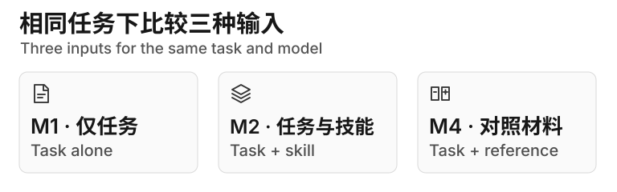

# SkillFit

[English](README.en.md) · 简体中文

在同一任务和模型上比较三种输入：仅给任务、加载技能、提供对照材料。静态矩阵可以浏览历史得分，查看哪些组合有足够的对照数据。



## 打开矩阵

在仓库根目录用 Python 3.10+ 启动本地服务，然后在浏览器打开 <http://127.0.0.1:8000>。

```sh
python3 -m http.server 8000 --bind 127.0.0.1 --directory site
```

也可以离线检查单个技能的对照覆盖：

```sh
python3 tools/value_audit.py --site-data site/data.json --skills humanizer --format markdown
```

多数公开条目只有加载技能后的得分。判断技能贡献需要同任务、对照输入和共同评审者，离线审计会标出缺项。从头执行模型实验需要另行配置 CLI 或 API，可能产生费用。

[测量方法](docs/measurement-audit.md) · [复现指南](docs/reproducibility-review.md) · [任务样例](example-tasks/format-check/) · [MIT 许可证](LICENSE)
