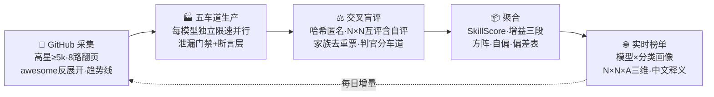

# 🧩 SkillFit — 技能与模型的契合度基准

> **三问三答：**  
> 1️⃣ 哪个 **skill 配哪个模型**最搭？→ 1169 技能 × 5 模型家族的实测配对矩阵  
> 2️⃣ 同类 **skill 里谁最强**？→ 80 组功能分类基准（N×N×A，star 最高者为 baseline）  
> 3️⃣ 哪个**模型在哪类任务**称王？→ 82 分类 × 5 模型强项画像


-orange)


现有"技能榜"只数 GitHub star，学术基准只评模型。SkillFit 用**真实跑任务 + 跨厂商交叉盲评**给出每一个 技能×模型 配对的实测契合度——全网第一个按"配对"出分的中文榜单。

---

## 📊 我们实测了什么

| 维度   | 数据                                                                                                     |
| ---- | ------------------------------------------------------------------------------------------------------ |
| 采集技能 | **1252 个**（高星 ≥5k + 趋势线 + awesome 反向展开，覆盖 anthropics / openai / github / cloudflare / vercel 等 40+ 组织） |
| 生产矩阵 | 每技能 × **5 个模型家族**真实做任务（~6200 格产物）                                                                      |
| 交叉盲评 | 产物匿名哈希代号 → 互为生产者与判官的 **N×N 方阵**（19,000+ 份判分，含对角线自评）                                                    |
| 功能分组 | 94 组自动聚类 + **N×N×A 三维对比**（80 组，组内 star 最高者为基准）                                                         |
| 模型画像 | **82 个功能分类 × 5 模型**的强项矩阵                                                                               |
| 中文释义 | 1134 条一句话功能说明（LLM 批量生成）                                                                               |
| **数据快照** | **2026 年 10 月 11 日**（管线每日自动更新，榜单持续滚动）                                                                     |

### 一个真实发现

> **没有最好的模型，只有最佳配对。** space-bunny 全库综合最强（499 次最佳搭配），但 **humanizer 技能上 deepseek 屠榜（95.0 vs 74）**；kimi 拿最多次单项冠军却综合第三——窄而尖 vs 全能型的差异，只有实测矩阵能看出来。

---

## 🔬 方法论（抄不走的四件事）

<details>

<summary><b>① 四模式对照——把"真增益"从"假增益"里拆出来</b></summary>

| 模式          | 内容          | 测什么                                 |
| ----------- | ----------- | ----------------------------------- |
| **M1** 裸跑   | 只给任务        | 模型基线                                |
| **M2** 强制加载 | 任务 + 技能文档全文 | skill 总增益                           |
| **M3** 触发模拟 | 全技能清单自由选择   | description 触发准确率（正例+负例）            |
| **M4** 等长对照 | 等长无关材料      | **拆穿长度安慰剂**（SkillsBench 论文自认未做的对照组） |

增益三段解构：`M4−M1` = 上下文变长的假增益 ｜ `M2−M4` = 纯内容增益 ｜ `hake = Δ/(5−M1)` = 吃掉多少剩余提升空间

</details>

<details>

<summary><b>② N×N 交叉盲评 + 对角线自评</b></summary>

- 每个模型既是**生产者**也是**判官**：行均 ≈ 真实水平，列均 = 判官严格度，对角线 = 自偏（实测 space-bunny 自评 +0.32 轻度自抬）
- **家族去重票**：同家族判官先取均值只计 1 票（PoLL / Apple 相关性研究结论的工程落地）
- 稳定哈希代号：产物路径 → MD5，跨批次永不漂移；映射表物理隔离，判官永远不知道在评谁

</details>

<details>

<summary><b>③ 双层产物质量门禁</b></summary>

- **断言层**（判官之前）：`禁含/禁正则/必含/必正则` 零成本确定性检查，结果作为事实喂给判官
- **泄漏门禁**（评分之前）：自动识别 CLI agent 模型的原生工具调用泄漏（`<tool_call>` 等）与超短废稿，硬化 prompt 自动重跑——曾救回被系统性冤枉的 deepseek：修复后从榜二跃居 95.0 满分第一

</details>

<details>

<summary><b>④ SkillScore 单一总分（0-100）</b></summary>

```
SkillScore = M2均分/5 × 60  +  max(0, 20 − 8σ)  +  触发准确率 × 20
             └── 实力 60 分 ──┘   └── 稳定性 20 ──┘   └── 触发质量 20 ──┘
```

</details>

---

## ⚙️ 全自动流水线



- **7×24 常驻**：抓取 / 测试 / 网页刷新三条循环 + 每日 cron 监督（卡死自动重启）
- **自愈体系**：看门狗（OOM 30s 复活）、额度定时器（打空自动挂起/重置自动复工）、代理死亡自动切直连
- **自迭代**：每批自动生成复盘线索 → 24 条实战经验入册（工具泄漏根因 / 端点规则突变 / OOM 极限 / key 梯次耗尽……）

---

## 🚀 快速开始

```bash
git clone https://github.com/yourname/skillbench.git
cd skillbench

# 1) 配置模型通道（codebuddy CLI 需已登录；API key 走环境变量）
cp 密钥.env.example 密钥.env   # 填入你的 BigModel key（anthropic 兼容端点，免费通道）

# 2) 健康检查
python3 tools/bench.py doctor --models glm-5.3-flash,deepseek-v4.1-flash

# 3) 一条龙：采集 → 生产 → 盲评 → 聚合 → 出站（SkillFit 全流程）
python3 tools/collect.py --update --min-stars 5000 --trending --seed 5000
python3 tools/bench.py run   --skills <技能清单> --models <模型清单> --modes M1,M2,M3,M4
python3 tools/bench.py score --skills <技能清单> --scorers <判官清单>
python3 tools/bench.py agg   --skills <技能清单>
python3 tools/bench.py site

# 4) 本地看榜
cd 网站 && python3 -m http.server 8000   # http://localhost:8000
```

---

## 📁 项目结构

```
skillfit/
├── tools/
│   ├── bench.py          # 唯一执行器：doctor / check / run / score / agg / cross / selfscore / site
│   ├── collect.py        # GitHub 双线采集（高星 ≥5k + 趋势，翻页 + awesome 反向展开）
│   ├── 分组.py            # 功能分组（N×N×A 的 A 轴）
│   ├── 释义.py            # LLM 批量生成技能中文释义
│   └── 总览生成.py         # 按功能组分章的可读目录
├── 网站/
│   ├── index.html        # 标签页榜单（总览 / 技能榜 / 同类对比 / 实时动态）
│   └── data.json         # 全量蒸馏数据（1169 技能 + 画像 + 三维对比，快照 2026-10-11）
├── 示例任务集/humanizer/   # 任务与验收点范例（断言层 + 触发正负例 + 四模式）
├── 本地库/*.json          # 技能数据库（star / 分组 / 中文释义）
├── 抓取循环.sh / 测试循环.sh / 网页刷新.sh   # 三条常驻流水线
├── 密钥.env.example       # API key 模板（真实密钥永不入库）
└── LICENSE                # MIT
```

> 产物矩阵、判分明细与采集原文属运行时数据（体积大、含身份映射，且涉第三方原文再分发），**不入库**——`网站/data.json` 已含全部蒸馏结果，跑管线会在本地完整重建。

---

## 🗺️ Roadmap

- [x] 快扫层：通用任务全量初筛（1252 技能）
- [x] N×N 交叉盲评 + SkillScore + 模型×分类画像
- [x] N×N×A 三维对比（同功能组基准 baseline）
- [ ] **深评层**：top 技能专属任务集（Oracle 门禁 + 四模式全量）
- [ ] 公网部署 + 可嵌入徽章（"SkillBench 认证：最佳搭配 XX 模型"）
- [ ] 投稿通道：技能作者提交 → 自动进管线 → 上榜
- [ ] 新模型 48h 横评（模型发布自动入列）

## 🙏 致谢与差异

方法论吸收并超越了：[SkillsBench](https://skillsbench.ai)（补上了它论文自认缺失的等长对照）、[anthropics/skills](https://github.com/anthropics/skills)（expectations 断言）、[OpenAI eval-skills](https://developers.openai.com/blog/eval-skills)（触发正负例）、PoLL / Apple 判官相关性研究（家族去重票）。与 [skillleaderboard.com](https://www.skillleaderboard.com) 的区别：他们数 star，我们**实测出分**。

## 📄 License

MIT
