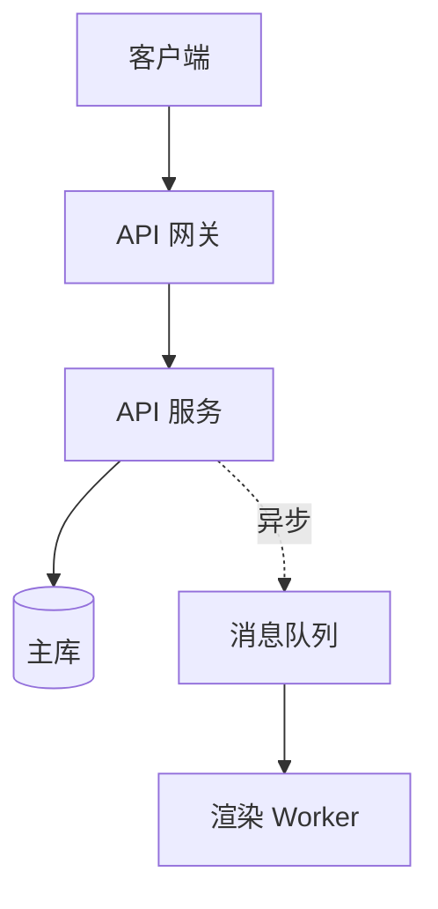

# API 与架构文档

## API 文档模板

先 endpoint 总表给全景，再逐接口细写（参数表 → 错误码表 → 最小 curl），全局约定（鉴权、分页、限流、幂等）殿后。

### endpoint 总表

| 方法 | 路径 | 用途 | 鉴权 | 幂等 |
|------|------|------|------|------|
| POST | /v1/reports | 生成报告 | Bearer | 否（带 Idempotency-Key 则是） |
| GET | /v1/reports/{id} | 查询报告 | Bearer | 是 |

### 参数表

| 参数 | 位置 | 类型 | 必填 | 默认 | 约束 | 说明 |
|------|------|------|------|------|------|------|
| title | body | string | 是 | — | 1~200 字符 | 报告标题 |
| format | query | enum | 否 | pdf | pdf / md / html | 输出格式 |

- 约束列必须可机读可人读（范围/枚举/正则）；写"合理值""任意字符串"等于没写。

### 错误码表

| HTTP | 业务码 | 含义 | 触发条件 | 处理建议 |
|------|--------|------|---------|---------|
| 400 | E_TITLE_TOO_LONG | 标题超长 | title 超 200 字符 | 截断或让用户修改 |
| 429 | E_RATE_LIMIT | 限流 | 超 100 次/分钟 | 按 Retry-After 头退避 |

- 错误码表是 API 文档的第二入口，用户排错先查这张表；每个业务码必须给"处理建议"，只写含义不写处理是半张表。

### 最小 curl 示例

```bash
curl -X POST https://api.example.com/v1/reports \
  -H "Authorization: Bearer <api-key>" \
  -H "Content-Type: application/json" \
  -d '{"title": "周报", "format": "md"}'
```

```text
预期输出（HTTP 201）
{"id": "r_9f3a", "status": "done", "url": "https://cdn.example.com/r_9f3a.md"}
```

- 一个接口一个最小示例：最少参数、真实返回；全参数轰炸留给参数表，不塞进示例。

### 幂等性标注规则

| 方法 | 默认幂等 | 标注要求 |
|------|---------|---------|
| GET / PUT / DELETE | 是 | 总表标"是"即可 |
| POST | 否 | 必须写重试策略：客户端带 `Idempotency-Key: <uuid>`，24 小时内同 key 返回同结果；扣费/下单/发消息类从建议升为必须 |

## 架构文档模板

### 四件套（缺一即半成品）

| 件 | 回答的问题 | 载体 |
|----|-----------|------|
| 组件图 | 有哪些部件 | mermaid 图 |
| 数据流 | 一条请求怎么走完 | 步骤表 |
| 依赖方向 | 谁依赖谁、为什么 | 图 + 依赖规则 |
| 故障域 | 哪里挂了会怎样 | 故障域表 |

### 组件图（mermaid）



- 每个节点一个词说职责；同步实线、异步虚线；参数不进图，进数据流表。

### 数据流表

| 步 | 组件 | 动作 | 输入 | 输出 | 耗时预算 |
|----|------|------|------|------|---------|
| 1 | 网关 | 鉴权 + 限流 | 请求头 | 放行 / 429 | ≤5ms |
| 2 | API 服务 | 落库 | JSON | report id | ≤20ms |
| 3 | Worker | 渲染 | 消息 | 文件 URL | ≤3s |

- 挑一条最典型的请求写全链路；耗时预算是性能契约，评审按此验收。

### 依赖方向规则

1. 箭头单向；出现环 → 当次重构第一优先级，文档必须记录环在哪。
2. 每条依赖写"为什么"：API → 主库（业务状态唯一真源）；API → 缓存（读多写少，2026-10-08 实测命中 92%）。
3. 上游不许感知下游实现："通过 X 接口调用"可写；"查 Y 表"出现在上游章节即违例。

### 故障域表

| 组件 | 挂了会怎样 | 降级方案 | 恢复步骤 |
|------|-----------|---------|---------|
| 缓存 | 读走主库，P99 上升 | 自动降级直查 | 重启 + 预热（runbook 链接） |
| MQ | 新任务堆积 | 告警 + 新请求限流 | 见 ops/mq 恢复手册 |

- 故障域表是架构文档的验收标准：评审者只看这张表，就知道作者有没有想清楚。

## ADR（架构决策记录）

一次决策一篇，文件 `docs/adr/NNN-短横线标题.md`，序号递增不复用。被推翻的 ADR 保留原文，状态改"被 NNN 取代"，不删除不改写。

### 四段式模板

```markdown
## 状态
已实施（2026-09-12）；取代 ADR-003
## 背景
v2.0 渲染 P99 = 8s（2026-08 压测，benchmarks/render.py）；Jinja2 沙箱配置复杂（issue #231，2026-08-15 报告）

## 决策
自研受限模板引擎，语法子集见 docs/template-spec.md

## 后果
- 正：渲染 P99 降至 3s（2026-10-08 压测）
- 负：新语法有学习成本；社区 Jinja2 模板不能直接用
- 复查点：2027-01；若模板相关报错占 issue 超 5%，重开决策
```

- 背景写当时的事实（带日期、带出处），不写"我们觉得"；后果正负都写，只写正面的 ADR 是宣传稿。

## changelog 规范

### Keep a Changelog 精要 + 中文惯用

| 英文类 | 中文惯用 | 收录范围 |
|--------|---------|---------|
| Added | 新增 | 新功能 |
| Changed | 变更 | 现有行为的修改；不兼容变更必须显式标注 |
| Deprecated | 废弃 | 即将移除的功能，写替代方案与移除版本 |
| Removed | 移除 | 本版真删掉的；先有 Deprecated 才能出现 |
| Fixed | 修复 | 缺陷修复，带 issue 号 |
| Security | 安全 | 漏洞修复，写影响版本范围 |

### 格式骨架

```markdown
## [未发布]
### 修复
- 深色模式下表格边框丢失（#482）
## [2.1.0] - 2026-09-30
### 新增
- 管道输入（#471）
### 变更
- **不兼容**：--output 参数改为必填（#477）
```

- 版本号遵循语义化版本：不兼容进主版本，新功能进次版本，修复进修订版本。
- 每条一行一个变更，带 issue/PR 号；"优化了若干问题"禁止出现——不可追溯的条目等于没写。

## 文档腐化防护（防腐三件套）

### 1. 文档与代码同 PR

| 变更类型 | PR 必须带上 |
|---------|------------|
| 接口增删、参数变化 | api.md 对应表格 diff |
| 版本发布 | CHANGELOG.md 该版本段 |
| 目录结构调整 | README 结构树 diff |

- CI 落地：`git diff --name-only` 检查 src 与 docs 联动，改了 src 未动 docs 的 PR 自动打标签提醒。

### 2. 过时标记规则

- 每篇文档尾部放 `<!-- last-verified: 2026-10-10 -->`；超过 180 天未更新 → 顶部加横幅"本文档超过半年未验证，以代码为准"。
- 确认失效且无人认领的文档直接删除：git 历史就是归档，不建 docs/old/ 坟场。

### 3. 断链检查命令

```bash
lychee --include-verbatim '**/*.md'          # 全仓链接（本地 + 远程）
npx markdown-link-check README.md docs/*.md  # Node 项目备选
```

- 进 CI 每周跑一次；死链修复责任人是该文档 owner，每篇文档头部标 `owner: <团队或人>`，换人时同步改。
